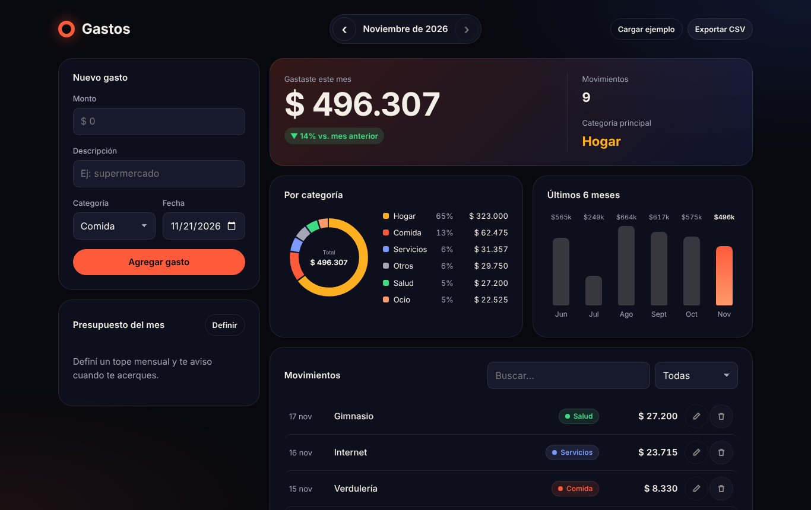
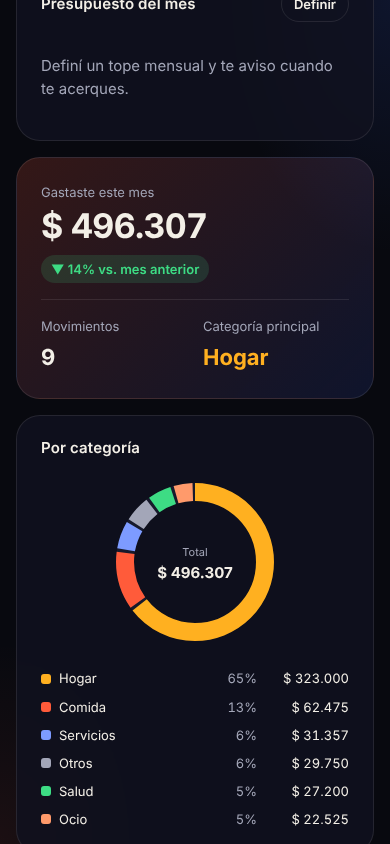

# Dashboard de Gastos

Aplicación web para registrar gastos personales y entender en qué se va la plata: totales por mes, comparación con el mes anterior, distribución por categoría, historial de 6 meses y presupuesto mensual.

**[Ver demo online →](https://facundo963.github.io/dashboard-gastos/)**





## Funcionalidades

- Carga, edición y eliminación de gastos, con **deshacer** en cada acción
- Montos en formato argentino (`12.500,50`) o con punto decimal
- Resumen del mes con variación contra el mes anterior
- Gráfico de dona por categoría y barras de los últimos 6 meses (SVG propio, sin librerías)
- Presupuesto mensual con barra de progreso y alertas por color
- Búsqueda y filtro por categoría
- Exportación a CSV compatible con Excel
- Datos de ejemplo para probarla en un clic
- Persistencia en `localStorage`
- Responsive y accesible: labels asociados, `aria-invalid`, foco visible y soporte para `prefers-reduced-motion`

## Stack

| Área | Tecnología |
| --- | --- |
| UI | React 18 + TypeScript (modo estricto) |
| Build | Vite |
| Estilos | Design system propio con CSS variables (tokens + componentes en `src/ui`) |
| Tests | Vitest + Testing Library |
| Contenedor | Docker multi-stage (Node para build, Nginx para servir) |
| CI/CD | GitHub Actions: typecheck, tests, build y deploy a GitHub Pages |

## Cómo correrlo

```bash
npm install
npm run dev        # http://localhost:5173
npm test           # corre los tests
npm run build      # genera dist/
```

Con Docker:

```bash
docker compose up --build   # http://localhost:8080
```

La imagen corre los tests durante el build: si un test falla, la imagen no se genera.

## Estructura

```
src/
├── components/   # Piezas de la pantalla (formulario, gráficos, lista)
├── ui/           # Design system: tokens.css, Button, Card, Field, Badge, ProgressBar
├── lib/          # Lógica pura y testeada: montos, fechas, agregaciones, CSV
├── hooks/        # Estado con useReducer + persistencia
├── data/         # Categorías y datos de ejemplo
└── App.tsx
```

La lógica de negocio vive en `src/lib` como funciones puras, separada de los componentes. Eso permite testearla sin renderizar nada y reutilizarla si mañana la app tiene un backend.

## Decisiones técnicas

- **Sin librería de gráficos.** La dona y las barras son SVG y CSS hechos a mano: pesan menos y se pueden animar y estilizar libremente.
- **Design system propio** en lugar de un framework de componentes, para practicar tokens, variantes y accesibilidad desde cero.
- **`useReducer`** para los gastos: todas las transiciones de estado están en un solo lugar y se testean como funciones puras.
- **Montos redondeados a centavos** en cada suma para evitar errores de coma flotante (`0.1 + 0.2`).

## Próximos pasos

- [ ] Gastos recurrentes (alquiler, servicios)
- [ ] Importar CSV de un banco
- [ ] Backend con Django REST y autenticación

---

Hecho por [Facundo Lopez](https://facundo963.github.io) · [LinkedIn](https://linkedin.com/in/facundo-lopez1999)
